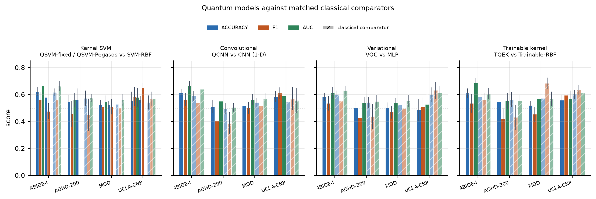
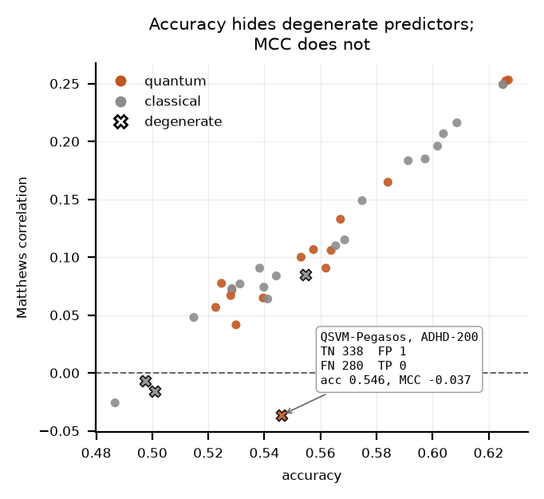
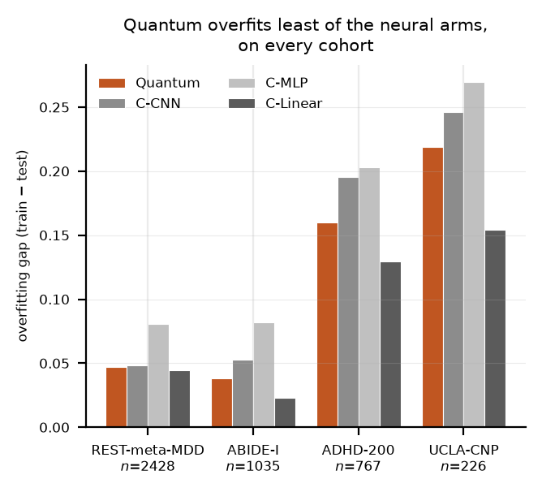
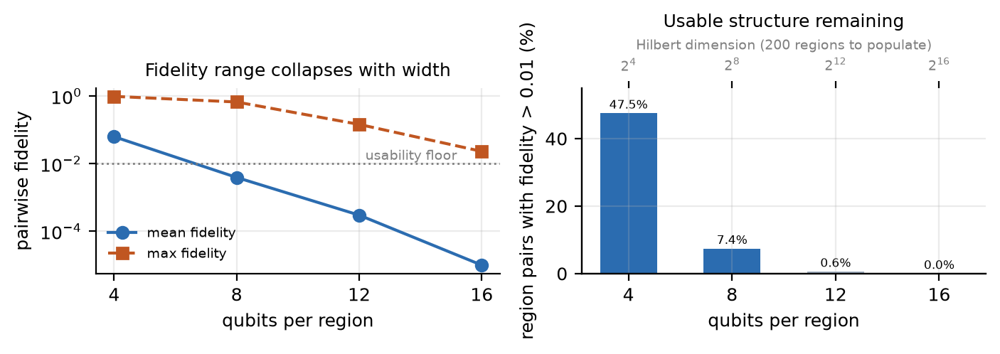
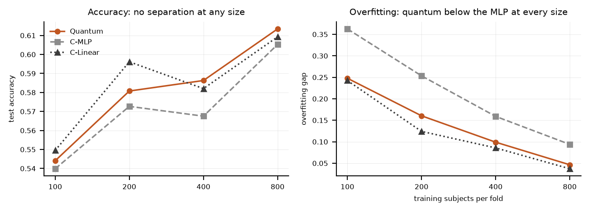
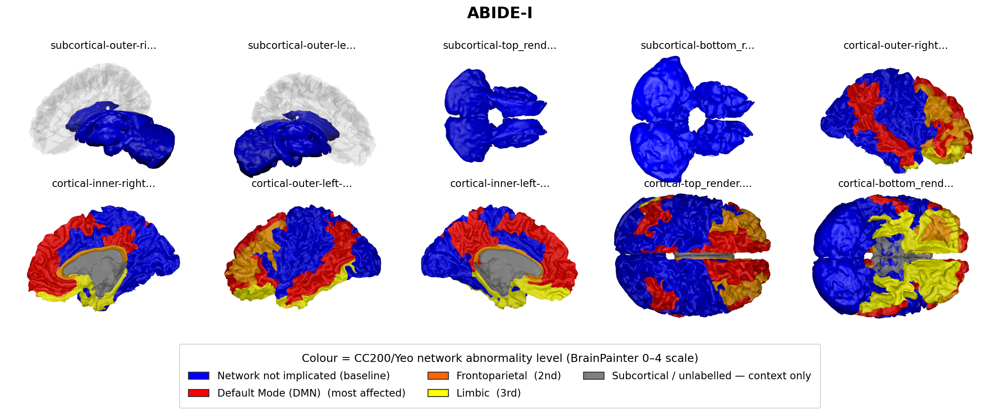
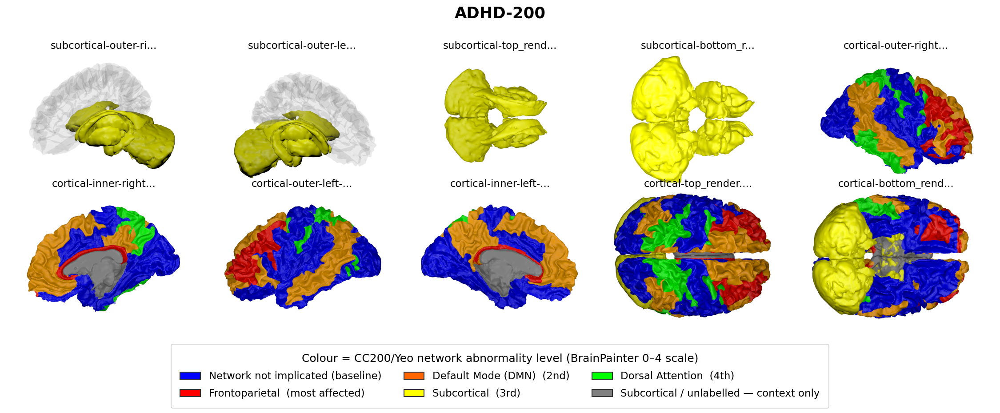
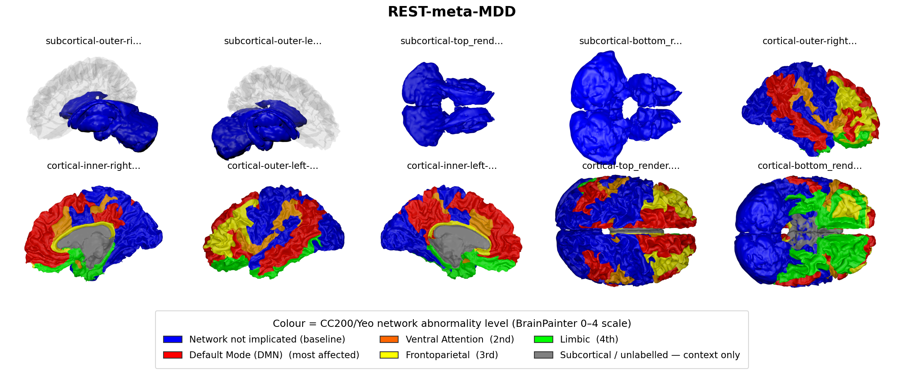
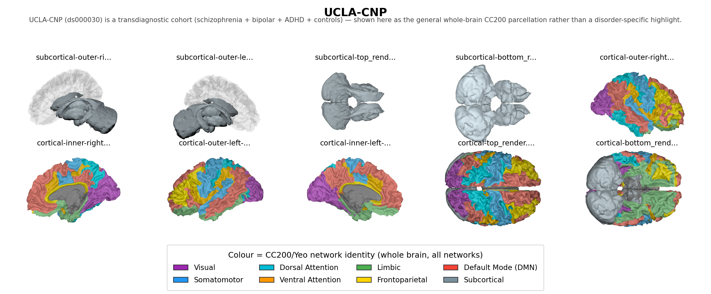

# qml-fmri-baseline

**Quantum Versus Classical Machine Learning for Neuropsychiatric Disorders:
A Feature-Matched Multi-Cohort Evaluation**

Utsav Poudel¹, Anuj Nepal², Vyas Viswanath¹, Subramaniyaswamy Vairavasundaram¹

¹ Vellore Institute of Technology, Vellore, India · ² Universal Higher Education, Melbourne, Australia

Code, per-fold results and analysis scripts for the manuscript. Every number in
the paper is recomputable from the stored fold records in `results/` without
retraining anything.

## What this is

Six quantum model families are evaluated against classical comparators matched
on features, capacity and training budget, on resting-state functional
connectivity from four clinical cohorts (4,308 subjects), under leave-site-out
validation. The
question is narrow and practical: given the same eight features and the same
optimisation budget a practitioner can actually afford today, does a quantum
model beat the classical model it replaces?

The answer is mostly no, and the value of the study is in *why* not. Two
constraints are measured rather than asserted: quantum fidelity concentrates
exponentially with register width, and a bounded Pauli-Z read-out caps
expressible capacity. Both are properties of the construction, not of the
implementation, so they set a boundary that a future architecture or device can
be measured against.

The repository also contains a general quantum-assisted adaptive graph learning
framework (`qagta`), which is where the study started. It works on any
multivariate temporal data.

## Headline result



Four matched pairings across four cohorts. Solid bars are quantum, hatched bars
are the classical comparator holding the same features and a comparable
parameter count. The two arms overlap almost everywhere.

Across **284 matched comparisons** on accuracy, F1, AUC and specificity, the
quantum arm leads in 115 and leads *significantly* in 30. Screening every
classical comparator for degeneracy, meaning sensitivity or specificity below
0.30 or |MCC| below 0.02 on the confusion matrix pooled over folds, and
excluding C-CNN, which fails to train on the small cohorts, removes 18 of those
30. Twelve survive. Nothing survives Bonferroni
correction at the scale of the sweep, and no significant accuracy advantage
exists against a functioning comparator on any cohort.

## Protocol

| | |
|---|---|
| Parcellation | CC200 (Craddock 2012), 200 regions, all four cohorts |
| Features | 8 per subject, from the connectivity descriptor, identical for both arms |
| Register | 8 qubits, exact statevector simulation |
| Validation | leave-site-out (ABIDE I, ADHD-200, REST-meta-MDD); 10-fold stratified for single-site UCLA-CNP |
| Folds | 20 / 7 / 25 / 10 |
| Testing | paired Wilcoxon signed-rank across folds, Bonferroni-corrected where the sweep is reported |
| Budget | 150 epochs, seed 0, matched across arms |

Matching is the point. A quantum model is never compared against the best
classical number available anywhere, only against the classical model it
displaces at the same feature and capacity budget.

## Results

Accuracy / AUC, mean over folds. Quantum arms in bold. QSVM-Pegasos returns
thresholded predictions only, so it has no AUC.

| model | ABIDE I<br>n=1035 | ADHD-200<br>n=619 | REST-meta-MDD<br>n=2428 | UCLA-CNP<br>n=226 |
|---|---|---|---|---|
| **QCNN** | 0.615 / 0.666 | 0.512 / 0.551 | 0.517 / 0.561 | 0.585 / 0.589 |
| **VQC** | 0.582 / 0.612 | 0.503 / 0.538 | 0.505 / 0.540 | 0.486 / 0.528 |
| **QSVM-Pegasos** | 0.579 / n/a | 0.561 / n/a | 0.523 / n/a | 0.561 / n/a |
| **QSVM-fixed** | 0.622 / 0.663 | 0.546 / 0.561 | 0.522 / 0.547 | 0.554 / 0.579 |
| **TQEK** | 0.610 / 0.686 | 0.549 / 0.551 | 0.519 / 0.570 | 0.558 / 0.569 |
| CNN (1-D) | 0.589 / 0.638 | 0.495 / 0.504 | 0.540 / 0.568 | 0.544 / 0.555 |
| MLP | 0.600 / 0.629 | 0.540 / 0.548 | 0.523 / 0.553 | 0.597 / 0.611 |
| SVM-RBF | 0.616 / 0.662 | 0.571 / 0.573 | 0.526 / 0.561 | 0.540 / 0.569 |
| Trainable-RBF | 0.581 / 0.606 | 0.562 / 0.554 | 0.571 / 0.566 | 0.602 / 0.610 |
| *majority class* | 0.512 | 0.548 | 0.535 | 0.549 |

Cohort matters more than model family. ABIDE I has roughly 0.10 of headroom
above its majority rate; ADHD-200 has 0.01. Almost every clean quantum win is on
ABIDE I, which is the cohort where there is signal to win with.

Regenerate this table, then the full sweep with every significant win listed:

```bash
python scripts/make_metrics.py --all
python scripts/advantage_sweep.py --list
```

### What survives the degeneracy filter

The main surviving results, with per-fold paired tests:

| result | cohort | metric | Δ | p |
|---|---|---|---|---|
| QCNN vs matched CNN | ABIDE I | AUC | +0.037 | 0.033 |
| QCNN vs matched CNN | ABIDE I | specificity | +0.038 | 0.030 |
| QCNN vs matched CNN | ABIDE I | accuracy | +0.044 | 0.058 |
| TQEK vs Trainable-RBF | ABIDE I | AUC | +0.064 | 0.0012 |
| TQEK vs Trainable-RBF | ABIDE I | specificity | +0.111 | 0.0006 |
| TQEK vs Trainable-RBF | ABIDE I | accuracy | +0.028 | 0.049 |
| Q-Reup2 vs C-MLP | ABIDE I | AUC | +0.053 | 0.0032 |
| Q-Plain vs C-MLP | ABIDE I | AUC | +0.055 | 0.0094 |
| H-QCNN vs linear control | ABIDE I | AUC | +0.017 | 0.024 |

QCNN also records the highest pooled Matthews correlation (0.253) and balanced
accuracy (0.626) in the matched suite on ABIDE I, quantum or classical, against
0.216 for the MLP and 0.207 for the CNN. The TQEK result does not replicate: it is −0.013
on REST-meta-MDD and −0.045 on UCLA-CNP.

Full ledger with the discarded wins and why each was discarded:
[`findings/24_quantum_advantage_ledger.txt`](findings/24_quantum_advantage_ledger.txt).

### Accuracy hides broken comparators; MCC does not



Four classical arms across the sweep sit at chance on the pooled confusion
matrix while still reporting plausible accuracy. QSVM-Pegasos on ADHD-200 pools to 0.546 accuracy with zero true
positives across every fold, which is a Matthews correlation of −0.037. Reporting accuracy
alone against a comparator like this manufactures a quantum advantage out of
nothing. Degenerate arms like this, together with C-CNN, which fails to train,
account for 18 of the 30 significant wins.

### The one effect that replicates everywhere



The quantum arm overfits less than both neural comparators on all four cohorts,
significantly on three (p = 0.001, 0.047, <0.001; UCLA-CNP p = 0.193). This is
the most robust quantum-specific effect measured here. The mechanism is
structural: a bounded Pauli-Z read-out caps expressible capacity, so the circuit
regularises without tuning. It does not convert into better test accuracy.

### Where fidelity stops carrying information



At the 16-qubit width the adaptive graph architecture was designed for, all
19,900 region-pair overlaps fall below 0.01 and the learned topology carries no
information. This is exponential concentration, a known property of fidelity
kernels, not an implementation fault. Narrowing to eight qubits restores usable
structure, and at that width the quantum fidelity kernel and a classical RBF
kernel given the same eight features become statistically indistinguishable.
This is the constraint that sets the register width for everything else here.

### Scarce data does not favour the quantum arm



A common claim is that quantum models win when data is scarce. Subsampling the
training pool inside fixed leave-site-out folds down to 100 subjects, that does
not happen: no separation in accuracy at any training size. The overfitting
advantage persists across the whole range, which is consistent with the
structural explanation above.

## Cohorts and the networks reported for them

All four cohorts use the CC200 parcellation, whose 200 regions map onto the
seven canonical Yeo networks plus subcortical structures. The renderings below
show which networks the clinical literature reports as disrupted in each
disorder: red most affected, then orange, then yellow, with blue marking
networks not implicated and grey unlabelled subcortical context.

**These summarise prior literature, not results from this repository.** No
experiment here localises a network. The models operate on the whole brain with
no regional prior, and the graph configurations sit at chance
(`findings/06`). They are included to situate the cohorts.

### ABIDE I, autism, default-mode leading



### ADHD-200, frontoparietal leading



### REST-meta-MDD, default-mode, reported as *hyper*-connectivity



### UCLA-CNP, transdiagnostic, shown as the parcellation itself

UCLA-CNP (ds000030) spans schizophrenia, bipolar disorder, ADHD and controls, so
no single disorder profile applies. Its panel instead shows the CC200/Yeo
parcellation coloured by network identity, which doubles as the atlas reference
for all four cohorts since every cohort here uses the same parcellation.



Renderings produced with **BrainPainter**:

> R. V. Marinescu, A. Eshaghi, D. C. Alexander and P. Golland.
> *BrainPainter: A software for the visualisation of brain structures,
> biomarkers and associated pathological processes.*
> Multimodal Brain Image Analysis and Mathematical Foundations of
> Computational Anatomy (MBIA/MFCA), LNCS 11846:112–120, 2019.
> [arXiv:1905.08627](https://arxiv.org/abs/1905.08627) ·
> [source](https://github.com/razvanmarinescu/brain-coloring)

Network assignments follow Yeo et al. (2011); the disorder-specific rankings are
drawn from the literature cited in the manuscript.

## Install

```bash
python3.13 -m venv .venv && source .venv/bin/activate
pip install -e ".[dev,viz,quantum,neuro]"
```

`quantum` brings PennyLane and the lightning simulator; `neuro` brings nilearn
for dataset access. The built-in PyTorch simulator needs neither, so
`pip install -e ".[dev]"` is enough for the generic framework. An optional
Qiskit reference path installs with `pip install -e ".[qiskit]"`. The exact
package versions used for the resubmission experiments are pinned in
`requirements-lock.txt` (Python 3.13.7, CPU only).

## Reproducing the study

Cohort data is not redistributed here. ABIDE I and ADHD-200 download from their
public archives; REST-meta-MDD and UCLA-CNP require their own access agreements.

```bash
python scripts/download_abide.py            # 1035 subjects, 20 sites, ~406 MB
python scripts/run_quantum_models.py --data-root data/ABIDE-I --out results/qmodels
```

`run_quantum_models.py` is the main experiment: it trains all five quantum
families and their matched classical comparators under leave-site-out folds and
writes per-fold records plus paired tests to a single JSON.

It also records training accuracy for every model, and
`--connectivity mutual_information` swaps Pearson correlation for a rank-based
mutual-information measure that registers non-linear dependence.

The experiments added for the IEEE Access resubmission run from one driver,
four jobs at a time, and write to `results/revision/`:

```bash
bash scripts/run_revision.sh
```

To recompute summaries from the stored records without retraining:

```bash
python scripts/make_metrics.py --all      # confusion matrices, MCC, balanced accuracy
python scripts/analyse_plans.py --plan C  # pooled paired tests for one intervention
```

### Quantum backend

Two interchangeable backends, pinned to agree numerically in CI (expectation
values to 1e-5, statevector overlap above 0.99999, gradients to 1e-4):

| backend | per subject (200 regions, fwd+bwd) | |
|---|---|---|
| `--backend torch` | **1.9 s** | batched statevector, default |
| `--backend pennylane` | ~12.6 s | `lightning.qubit`, adjoint differentiation |

The speedup is an execution-strategy win, not an approximation: the workload is
the same circuit run once per region, which vectorises.

## The general framework

Independently of the clinical study, `qagta` implements quantum-assisted
adaptive graph learning for any multivariate temporal data.

```
multivariate time series
        │
        ▼
  angle encoding ──▶ variational quantum circuit ──▶ ⟨Z⟩ expectation values
        │                                                    │
        │                                              latent embeddings z
        ▼                                                    │
  adaptive edge learning  ◀────── quantum fidelity |⟨ψi|ψj⟩|² ┘
        │
        ▼
  differentiable adjacency ──▶ graph attention propagation ──▶ fused representation
        │                                                              │
        └──────────── hybrid optimisation (backprop + parameter shift) ─┘
```

```bash
python scripts/generate_data.py --samples 300 --features 10 --out data/synthetic.csv
python scripts/run_pipeline.py --data data/synthetic.csv
```

```python
from qagta import PipelineConfig, QuantumAdaptiveGraphPipeline
from qagta.data import load_csv_dataset

split = load_csv_dataset("data/synthetic.csv")
pipeline = QuantumAdaptiveGraphPipeline(PipelineConfig(), input_dim=split.n_features)
pipeline.fit(split.x_train)
print(pipeline.evaluate(split.x_test, split.y_test).summary())
```

Edge weights come from a parametric kernel mixing four similarity notions, with
trainable softmax-normalised mixing coefficients:

```
W_ij = α·cosine(z_i, z_j) + β·learnable(z_i, z_j) + γ·attention(z_i, z_j) + δ·fidelity(ψ_i, ψ_j)
```

Candidate edges come from k-nearest-neighbour sparsification, and retained
weights stay differentiable, so gradients from the graph objective reach both
the kernel and the quantum circuit. Classical parameters update by
backpropagation; quantum circuit parameters can co-adapt through autograd or
through the parameter-shift rule, which remains valid on shot-based backends and
real hardware. The test suite verifies the two agree to 1e-4.

Every stage is configurable via YAML, see
[configs/default.yaml](configs/default.yaml). Notable knobs: `quantum.n_qubits`
(sets latent dimensionality), `graph.k_neighbors` and `graph.edge_threshold`
(topology density), `graph.use_fidelity` (quantum similarity term),
`model.encoder` (`gat` or `sage`), and `training.quantum_gradient`
(`autograd` or `parameter_shift`).

## Layout

```
src/qagta/
  quantum/          quantum models and the simulator they run on
    simulator.py      differentiable batched statevector backend
    qcnn.py           quantum convolutional network (Cong et al.), Qiskit-equivalent to 1e-6
    variational.py    variational classifier: ZZFeatureMap, RealAmplitudes, parity read-out
    kernel.py         fidelity kernel and Gram-matrix construction
    trainable_kernel.py  quantum embedding kernel trained by kernel-target alignment
    tensor_vqc.py     TTN-VQC and TensorHyper-VQC (Qi et al.) and parameter-matched classical twins
    graph_transformer.py quantum self-attention: query and key share one register
    hybrid.py         learned projection feeding a quantum or classical head (Plan A)
    ensemble.py       ensembles of narrow circuits over disjoint feature blocks (Plan B)
    fmri_encoder.py   per-region encoders, ring-entangled and interleaved
    fidelity.py       pairwise state overlap
    projected.py      projected quantum kernels
    qiskit_backend.py Qiskit reference path, for equivalence checks
  graph/            adaptive edge learning, connectome construction
  models/           graph attention and SAGE encoders, gated decision module
  training/         training loops, baselines, leave-site-out evaluation
  data/             cohort loaders, connectivity descriptors (Pearson or mutual information), feature compression
  pipeline.py       end-to-end orchestration

scripts/
  # model training and evaluation
  run_quantum_models.py   the model suite: QCNN, VQC, two QSVMs, TQEK, and matched classical arms
  run_abide_study.py      graph pipeline: quantum edges into a GAT, against classical GNNs
  run_quantum_kernel.py   fidelity kernel against classical kernels
  run_population_graph.py subjects as nodes, quantum edges between them
  run_benchmark.py        matched-feature comparison across cohorts
  # interventions on the feature budget
  run_hybrid.py           Plan A, projection learned jointly with the circuit
  run_ensemble.py         Plan B, ensembles over disjoint feature blocks
  run_reupload.py         Plan C, data re-uploading at fixed register width
  run_qubit_scaling.py    does a wider register help a variational model?
  run_graph_transformer.py quantum attention against classical attention
  # follow-up experiments
  run_lowdata.py          does the quantum arm win when training data is scarce?
  run_calibration.py      does per-fold threshold calibration convert AUC into accuracy?
  run_permutation_null.py label-permutation null for the matched kernel comparisons
  run_pca_basis_test.py   does a per-subject PCA basis destroy the node features?
  run_graph_foldwise.py   graph study with a fold-wise PCA basis (finding 26)
  run_graph_trained_encoder.py graph study with the quantum encoder trained jointly (finding 27)
  run_shot_budget.py      shot budgets and projected kernels for the quantum kernel
  # resubmission experiments (driver: run_revision.sh)
  run_tensor_vqc.py       TTN-VQC and TensorHyper-VQC on 2,000 features against matched twins
  run_baseline_sensitivity.py do the quantum wins survive classical comparators retuned per fold?
  run_kernel_generalization.py does effective dimension track generalization for both kernels?
  # analysis and reporting
  advantage_sweep.py      every matched comparison, screened for degenerate comparators
  analyse_plans.py        pools a plan across cohorts, flags which arm loses each test
  make_metrics.py         confusion matrices, sensitivity, precision, MCC from stored folds
  make_figures.py         every figure in the manuscript
  make_tables.py          result tables
  # data acquisition
  download_abide.py, download_adhd200.py, ingest_cohort.py,
  ingest_adhd200_athena.py, make_mdd_phenotypic.py, generate_data.py
  # drivers
  run_all_cohorts.sh, run_plans_ab_cohorts.sh, run_qgt_all.sh, run_sweep.sh,
  rerun_after_fix.sh, rerun_parallel.sh, resume_rerun22.sh, run_encoder_ab.sh,
  run_revision.sh

findings/         one file per measured result, 01 to 28; see findings/README.md
results/          per-fold metrics and figures; see results/README.md
  rerun22/          the corrected runs behind every number in the paper
docs/figures/     figures used in this README
tests/            86 tests covering the simulator, models, graph and pipeline
```

### Where to start

Reproducing a number from the paper: `results/README.md` says which run
directory holds it, and `analyse_plans.py` or `make_metrics.py` will recompute
the summary from the stored per-fold records without retraining anything.

Understanding what was measured and why: read `findings/README.md` first. It
gives the reading order and flags which findings were later revised. Finding 22
is the one to read if you only read one: it documents an encoding defect that
suppressed the quantum arm across the first round of results, and every number
reported here comes from the re-run after that fix.

Running an experiment yourself: every script under `scripts/` takes
`--data-root` and `--out`, defaults to ABIDE I, and prints per-fold results as
it goes.

## Tests

```bash
pytest
```

Coverage includes statevector normalisation and entanglement against analytic
results, parameter-shift gradients against autograd, edge-kernel
differentiability, over-smoothing resistance, and end-to-end pipeline behaviour.

## License

Apache-2.0. See [LICENSE](LICENSE).

> Note on scope: this repository is a general, self-contained implementation of
> the architecture. It is not a disclosure document, and it deliberately omits
> filing-specific material. Source specification PDFs are excluded from version
> control via `.gitignore`.
